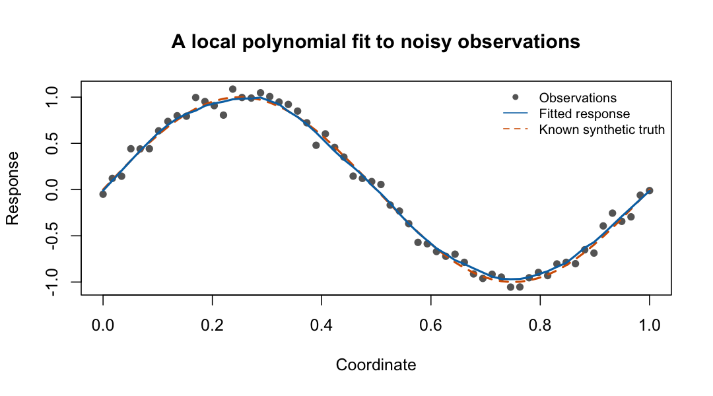

# geosmooth

`geosmooth` provides geometric methods for nonparametric regression and density
estimation on data represented as coordinate matrices or weighted graphs. It
includes local polynomial smoothing, model-averaged local polynomial smoothing,
local polynomial lifting trend filtering, synchronized local polynomial lifting
trend filtering, one-dimensional logistic trend filtering, graph low-pass
filtering, and Hessian-energy regression.



The points are observations, the solid line is a selected local polynomial fit,
and the dashed line is known synthetic truth. The
[first-fit guide](https://pgajer.github.io/geosmooth/articles/function-guide.html#a-first-regression-fit)
shows the code, selected settings, and how to interpret the tuning score.

For a task-based catalog of every exported function, prediction capabilities,
and examples, read [Finding your way around geosmooth](https://pgajer.github.io/geosmooth/articles/function-guide.html).
In an installed package, use `vignette("function-guide", package = "geosmooth")`
or start with `help("geosmooth-package", package = "geosmooth")`.

Browse the [reference by task](https://pgajer.github.io/geosmooth/reference/index.html),
[functions A–Z](https://pgajer.github.io/geosmooth/reference/alphabetical.html), or
[synthetic datasets guide](https://pgajer.github.io/geosmooth/articles/synthetic-datasets.html).
See [NEWS](https://pgajer.github.io/geosmooth/news/index.html) for migration details.

## Installation

For the version currently on CRAN:

```r
install.packages("geosmooth")
help("geosmooth-package", package = "geosmooth")
```

The 0.2.0 release candidate includes the guides below and requires R >= 4.1.0
and dgraphs >= 0.4.0. Its optional GRIP and edge-KK embeddings require
grip >= 0.3.0. These dependency releases must be available before the candidate
can complete CRAN-only validation. A source installation needs an R compilation
toolchain.

Once those dependencies are published on CRAN, install the candidate with:

```r
install.packages("pak")
pak::pkg_install("pgajer/geosmooth")
vignette("function-guide", package = "geosmooth")
```

The package-check and website workflows now resolve dependencies from CRAN.
Their next builds and the final **CRAN dependency check** remain pending until
dgraphs >= 0.4.0 and grip >= 0.3.0 are published. Earlier successful checks used
development dependencies and do not establish CRAN-only release readiness.
See [the submission draft](https://github.com/pgajer/geosmooth/blob/main/cran-comments.md) for the recorded status and
remaining validation.

## Quick Start

```r
library(geosmooth)

set.seed(1)
x <- seq(0, 1, length.out = 60)
X <- cbind(x = x)
y <- sin(2 * pi * x) + rnorm(length(x), sd = 0.08)
foldid <- rep(1:5, length.out = length(y))

lps.fit <- fit.lps(
    X = X,
    y = y,
    foldid = foldid,
    support.grid = c(8L, 12L, 16L),
    degree.grid = 0:1,
    kernel.grid = "gaussian"
)

head(predict(lps.fit))
```

`fit.lps()` is the canonical local polynomial smoother (LPS) entry point.  It
selects support size, local polynomial degree, and kernel by cross-validation.

## Method Map

Choose by the structure of your data and the penalty you need:

- **LPS**: local polynomial smoother, `fit.lps()`.
  Use this as the direct local-regression baseline.  It predicts by fitting a
  local polynomial around each evaluation point.

- **MALPS**: model-averaged local polynomial smoother, `fit.malps()`.
  Use this when you want many local polynomial fits around observed anchors and
  an averaged prediction surface.

- **LPL-TF**: local polynomial lifting trend filtering, `fit.lpl.tf()` and
  `lpl.tf.operator()`.
  Use this when the local polynomial residual operator should be regularized by
  an L1 (absolute-value) trend-filtering penalty.

- **SLPLiFT / S-LPL-TF**: synchronized local polynomial lifting trend
  filtering, `fit.slpl.tf()` and `slpl.tf.operator()`.
  Use this when you want LPL-TF plus a quadratic synchronization penalty across
  overlapping local predictions.

- **Graph low-pass**: `fit.metric.graph.lowpass()` smooths a response on an
  undirected graph with positive edge lengths or supplied nonnegative
  conductances. The
  [graph workflow](https://pgajer.github.io/geosmooth/articles/function-guide.html#from-a-constructed-graph-to-a-fitted-response)
  explains vertex alignment, length-to-conductance conversion, and basis reuse.
  The [observed-data heat guide](https://pgajer.github.io/geosmooth/articles/verified-heat-fallback.html)
  covers missing responses, numerical cross-checks, and unresolved tuning choices.

- **One-dimensional Gaussian trend filtering**: `fit.gaussian.trend.filtering()`
  fits continuous outcomes with an order-2 piecewise-quadratic curve.
  `assess.gaussian.trend.filtering()` retunes on each outcome permutation,
  compares held-out MSE/MAE with a training-only mean, and reports absolute
  deviation and total variation. The permutation null requires exchangeability;
  constant mean alone under arbitrary heteroskedasticity is insufficient.
- **One-dimensional logistic trend filtering**: `fit.logistic.trend.filtering()`
  fits a binary outcome over a continuous predictor. The
  [assessment function](https://pgajer.github.io/geosmooth/reference/assess.logistic.trend.filtering.html)
  tests constancy by permutation and measures predictive improvement.
  Likelihood remains the default test; absolute-deviation and total-variation
  summaries have optional permutation tests with Holm adjustment. The
  [logistic trend-filtering guide](https://pgajer.github.io/geosmooth/articles/logistic-trend-filtering.html)
  illustrates fitting and assessment on synthetic and Pima data.

- **SSRHE**: SSRHE-style Hessian-energy smoothing,
  `fit.ssrhe.hessian.regression()` and
  `fit.ssrhe.hessian.l1.regression()`.
  Use this as a Hessian-energy comparator with fixed-k, supplied, or
  graph-derived adaptive-radius neighborhoods.

## Basic Examples

### LPS

```r
lps.fit <- fit.lps(
    X = X,
    y = y,
    foldid = foldid,
    support.grid = c(8L, 12L),
    degree.grid = 0:1,
    kernel.grid = "gaussian"
)

lps.pred <- predict(lps.fit, X)
```

### MALPS

```r
malps.fit <- fit.malps(
    X = X,
    y = y,
    degree = 1L,
    support.type = "knn",
    support.size = 12L,
    kernel = "tricube",
    support.selection = "fixed",
    coordinate.method = "coordinates"
)
```

### LPL-TF and SLPLiFT Operators

```r
lpl.op <- lpl.tf.operator(
    X = X,
    degree = 1L,
    support.type = "knn",
    support.size = 12L,
    kernel = "gaussian",
    coordinate.method = "coordinates"
)

slpl.op <- slpl.tf.operator(
    X = X,
    degree = 1L,
    support.type = "knn",
    support.size = 12L,
    kernel = "gaussian",
    coordinate.method = "coordinates"
)
```

Fitting LPL-TF and SLPLiFT currently uses the optional `genlasso` dependency.

```r
if (requireNamespace("genlasso", quietly = TRUE)) {
    lpl.fit <- fit.lpl.tf(
        y = y,
        operator = lpl.op,
        lambda = 0.1,
        lambda.selection = "fixed"
    )

    slpl.fit <- fit.slpl.tf(
        y = y,
        operator = slpl.op,
        lambda1 = 0.1,
        lambda2 = 0.01,
        lambda.selection = "fixed"
    )
}
```

### SSRHE Hessian-Energy Regression

```r
grid <- expand.grid(x = seq(0, 1, length.out = 5),
                    y = seq(0, 1, length.out = 5))
X2 <- as.matrix(grid)
y2 <- sin(2 * pi * X2[, 1]) + 0.25 * X2[, 2]

ssrhe.fit <- fit.ssrhe.hessian.regression(
    X = X2,
    y = y2,
    k = 12L,
    tangent.dim = 2L,
    lambda1 = 0.05,
    return.local.diagnostics = FALSE
)

# Select penalties with the same fitter (use "gcv" for fully observed data).
ssrhe.cv <- fit.ssrhe.hessian.regression(
    X = X2,
    y = y2,
    k = 12L,
    tangent.dim = 2L,
    lambda.selection = "cv",
    lambda1.grid = c(0.01, 0.05, 0.2),
    cv.control = list(cv.folds = 5L)
)
```

The same runnable code is available in
`inst/examples/geosmooth_quickstart.R`.

## Graph Dependency Boundary

`geosmooth` owns smoother APIs and package-local coordinate/fixed-k paths.
Graph construction and shortest-path operations are supplied by `dgraphs`.

That means:

- Coordinate LPS, coordinate MALPS, coordinate LPL-TF/SLPLiFT, fixed-k SSRHE,
  and supplied-neighborhood SSRHE are package-local `geosmooth` paths.
- Graph-dependent paths, including graph-geodesic MALPS/LPL-TF/SLPLiFT
  supports and SSRHE adaptive-radius neighborhoods, use compatible `dgraphs`
  graph objects.
- `geosmooth` does not currently export graph construction functions such as
  rKNN graph builders.

Native support currently includes:

- C++ coordinate backend for LPS CV and prediction
- C++ shared local-PCA chart backend
- C++ SSRHE Hessian-energy operator backend

## Native Backends

The package includes compiled backends for LPS cross-validation and
prediction, shared local-PCA chart construction, metric-graph low-pass
filtering, and SSRHE Hessian-energy operators.

## Validation

Focused validation:

```sh
make test
make check-fast
```
